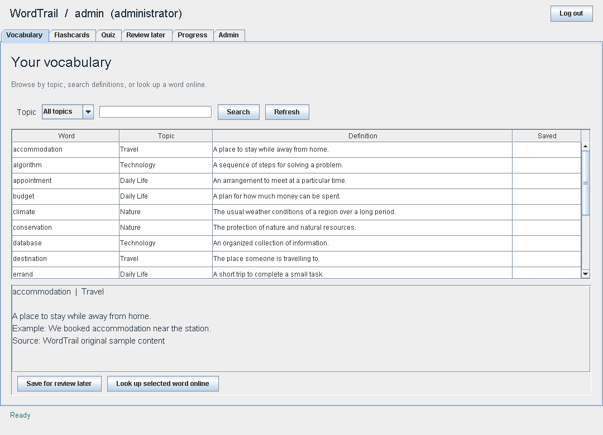
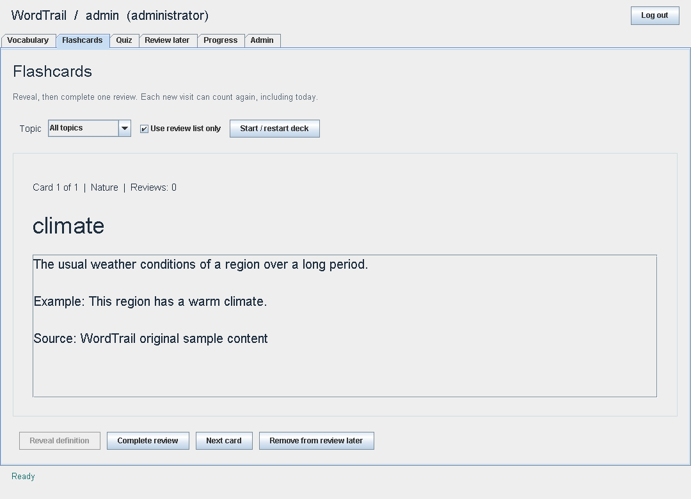

# WordTrail — Vocabulary Learning

A Java 11 / Swing desktop application for learning English vocabulary. Browse
topics, study flashcards, take quizzes, save difficult words and track progress.
Administrators add vocabulary and multiple-choice questions through forms.

[中文启动与修改说明](docs/QUICKSTART.zh-CN.md)

This working copy is **local only**, as requested. No branch was uploaded and no
remote PR was created. Keep development, commits and review materials on this device.

## Run

Install a **JDK 11 or later** and **Maven 3.9 or later**, then run from the project root:

```sh
mvn verify
java -jar target/wordtrail.jar
```

On Windows, double-click `run.cmd`, or run `.\run.ps1`. The launcher uses the
project directory for saved data and rebuilds when source files have changed.
Use `.\run.ps1 -Build` to force a complete build, or `.\run.ps1 -Check` to check
the packaged entry point without opening a window or accessing the internet.

The local delivery also includes `target/wordtrail-local.zip` (JAR, Windows launcher
and short instructions) and `target/wordtrail-local.bundle` (an offline Git history
backup). These generated artifacts stay on this device and are ignored by Git.

In IntelliJ IDEA, open `pom.xml` as a Maven project, select JDK 11+, and run
`com.wordtrail.app.Main`. Keep the working directory set to the project root.

The first launch asks you to create an administrator. Choose your own username
and password; no default credentials are shipped. Log out and select **Register
a learner account** to create ordinary learner accounts. Usernames are case
insensitive. All registered learners can use all learning features.

```sh
java -jar target/wordtrail.jar --data-dir path/to/my-data
java -jar target/wordtrail.jar --check-api hello
```

The second command performs a live dictionary diagnostic without opening the GUI
or modifying saved data. The packaged JAR contains its JSON dependency and seed
content, so Maven is not required on the machine running the JAR.

## Features and stories

| Story | Behavior | Lead owner |
| --- | --- | --- |
| US-01 | First-run admin setup, learner registration, login and logout | Team to assign |
| US-02 | Topic vocabulary, case-insensitive search, live dictionary lookup | Team to assign |
| US-03 | Reveal flashcards, mark studied, study the review list | Team to assign |
| US-04 | Randomized four-choice quizzes, feedback and saved results | Team to assign |
| US-05 | Add/remove words from a private review list | Team to assign |
| US-06 | Distinct words studied, daily chart, streak and quiz history | Team to assign |
| US-07 | Admin forms for new words, topics and quiz questions | Team to assign |

All seven software stories are implemented. The actual team must assign ownership,
agree its contract, review changes and record its own contributions. This code was
produced with AI assistance at the user's request; commit authorship does not
represent independent contributions by multiple teammates.

## API and persistence

- **External API:** [Free Dictionary API](https://dictionaryapi.dev/),
  `GET https://api.dictionaryapi.dev/api/v2/entries/en/{word}`. No API key required.
  Use **Look up selected word online** in Vocabulary or **Fill from online
  dictionary** in Admin. Lookup returns the first usable definition and optional
  example, with the request URL retained as attribution.
- **Persistence:** `.wordtrail/wordtrail.json`, UTF-8 JSON. Accounts, salted PBKDF2
  hashes, admin content, review lists, study dates and completed quizzes survive
  restart. Accounts share vocabulary; learning records belong to individual users.
- **Offline:** 16 original sample words and 16 questions across Travel, Technology,
  Daily Life and Nature. Local learning works without internet. API errors appear
  in the status area and do not pretend to be successful lookups.
- **File safety:** write a temporary snapshot, flush it and replace the data file;
  use an OS process lock to prevent two instances overwriting one folder. Invalid
  data is preserved and reported. Close the app before backing up the JSON file.
- The supplied `DBUserDataAccessObject.java` informed the repository/adapter design.
  This project uses a public dictionary API plus local storage instead of the
  example's shared HTTP user server. Both course requirements are met separately.

Local storage is intended for a classroom desktop demo. Anyone with write access
to the data folder can edit its contents. Cross-device sync, remote account
security and password recovery are future extensions.

## Design

```text
Swing view → controller → input boundary / interactor → entity
                           ↓ repository / gateway ports
                     JSON, PBKDF2, HTTP adapters
Interactor results → presenter → plain view models → Swing view
```

`entity` and `usecase` contain no Swing, HTTP or JSON dependencies. `Application`
wires implementations through interfaces. Seven use-case interfaces give each
story a focused boundary. Background `SwingWorker` tasks keep I/O off the EDT.
Repository, Adapter, Strategy and dependency injection patterns support the design.

## Validation

`mvn verify` runs 25 JUnit tests: business rules, hashing, atomic persistence,
malformed data, local HTTP responses, architectural dependencies, presenters and
an end-to-end Swing flow. Automated tests use a local HTTP server or injected
dictionary double; they do not rely on the public API being online. A manual
`--check-api hello` checks the real service separately.

The Swing integration test clicks actual controls in headless mode, verifies all
seven stories and restarts the real JSON store. It writes screenshots to
`target/ui-snapshots/`. A CI workflow is prepared for Java 11 and 17 on Windows and
Linux; it has not been uploaded or run remotely in this local-only delivery.

## Screenshots

These are real Swing component renders from the integration test, with synthetic
demo accounts and content. Desktop fonts and window decorations vary by OS.





## Project documents

- [User stories and acceptance criteria](docs/USER_STORIES.md)
- [Architecture, patterns, SOLID and tradeoffs](docs/ARCHITECTURE.md)
- [UI wireframes](docs/UI_WIREFRAMES.md)
- [Local development and review workflow](docs/DEVELOPMENT.md)
- [Presentation and demo guide](docs/DEMO.md)
- [Verification record](docs/VERIFICATION.md)
- [Future extensions](docs/FUTURE_WORK.md)
- [Local review summary in PR format](docs/PR_DESCRIPTION.md)
- [Team contract template](TeamContract.md) — requires the actual team's agreement
