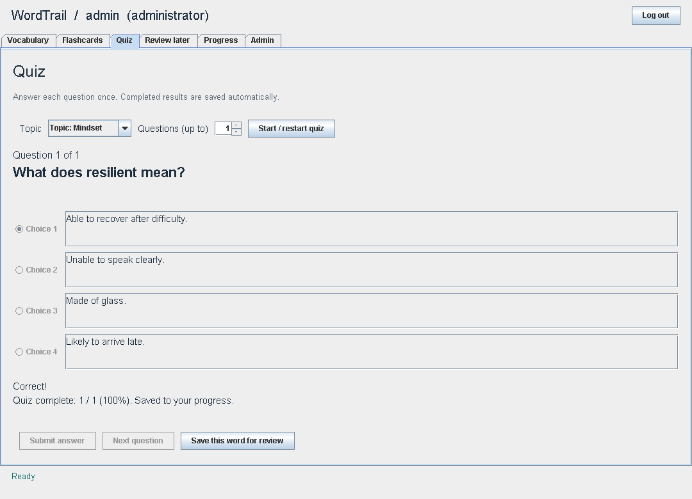
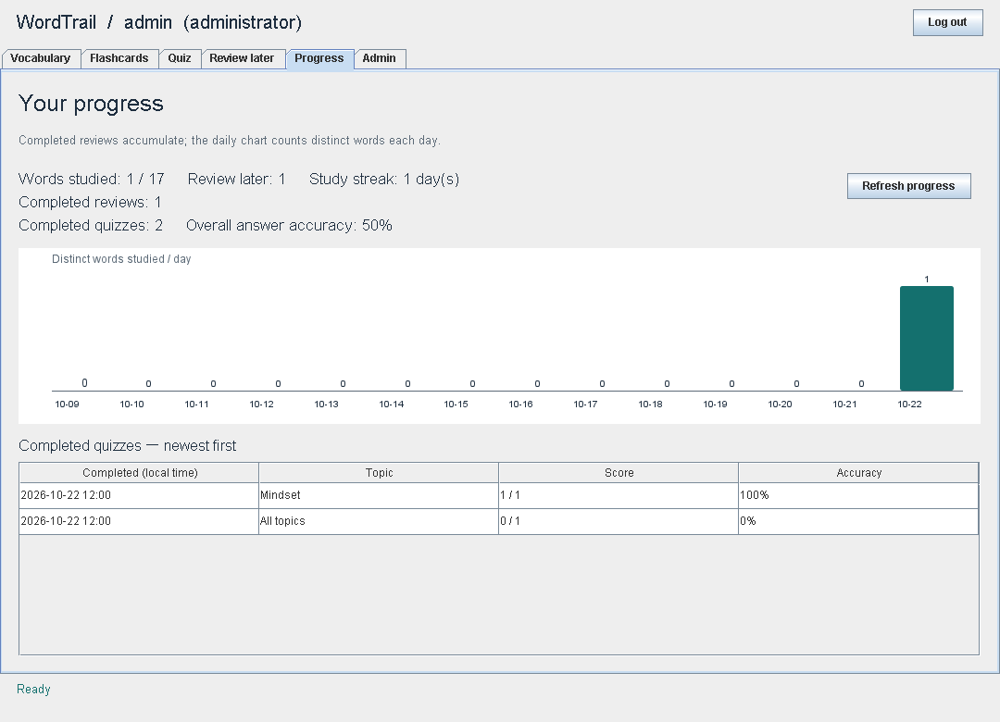
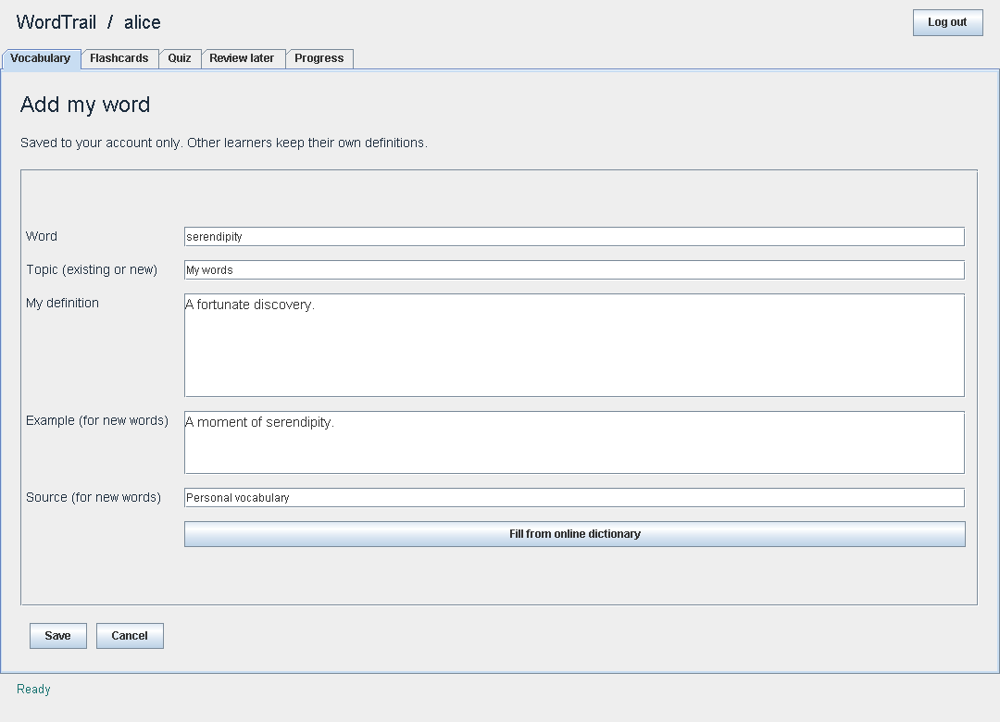
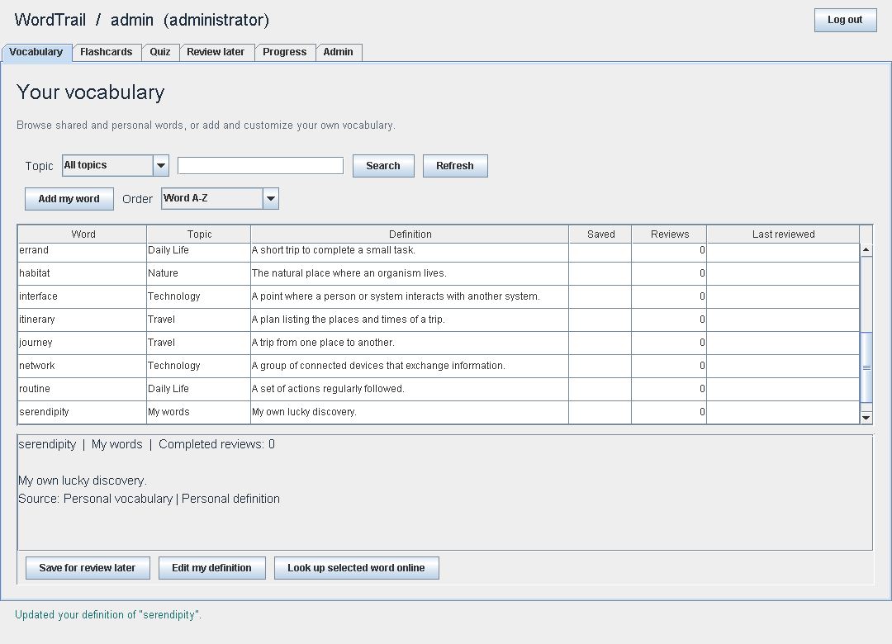
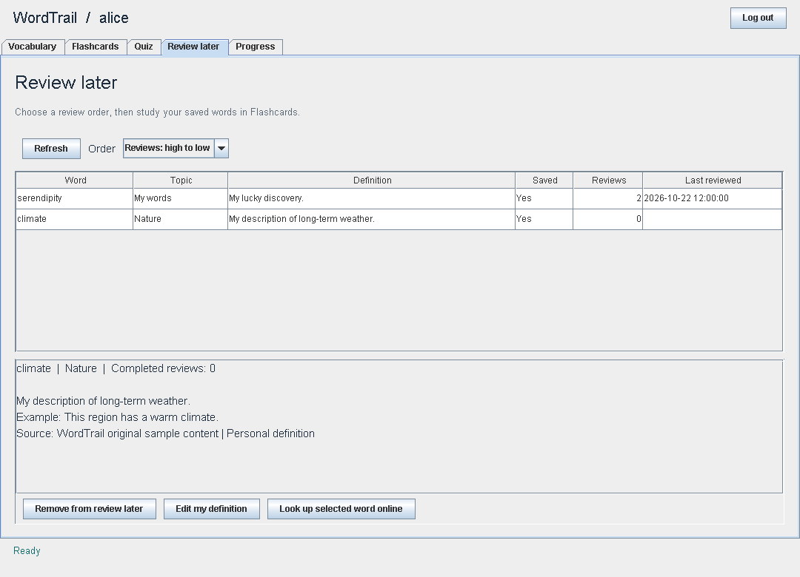

# WordTrail — Vocabulary Learning

**Guided-study preview:** The new **Study** tab restores the reference learning
loop: 20-word rounds, durable resume, wrong-only retests, mastery/goals, mistakes,
history replay and immediate placement replacement. See
[behavior, screenshots and validation](docs/GUIDED_STUDY.md) and
[the complete reference comparison](docs/REFERENCE_PARITY_AUDIT.md).
PR #17 consolidates this work and the earlier UI previews into one review against
`main`; the existing three team MVP use cases and their individual ownership are retained.

A Java 11 / Swing desktop application for learning English vocabulary. Browse
topics, study flashcards, take quizzes, save difficult words and track progress.
Learners can also maintain private vocabulary, export their quiz history and
generate a daily review plan. Administrators add shared vocabulary and
multiple-choice questions through forms.

**Domain:** Education / language learning. **Team:** Zidong Yuan
([fanfan170721](https://github.com/fanfan170721)), Fuxuan Xu
([Xfx689781](https://github.com/Xfx689781)) and Xinyu Huang
([XinyuuHuang](https://github.com/XinyuuHuang)).

[Running and modifying WordTrail](docs/QUICKSTART.md)

**Switching computers:** [Current progress and continuation instructions](docs/HANDOFF.md).

**Teammates continuing now:** [Completed feature work and remaining review/demo steps](docs/START_HERE.zh-CN.md).

This repository integrates the application with the
signed [team contract](TeamContract.md), merged through
[PR #1](https://github.com/fanfan170721/team-project/pull/1).
The implementation history is preserved. Code review and each member's own
use-case contribution must be assessed separately from the contract signatures.

**Published snapshot — November 22, 2026:** `main` at `77ea22e` contains all three
reviewed MVP flows, the package-verification improvements and the demo tools/guides.
[PR #13](https://github.com/fanfan170721/team-project/pull/13) published reviewed
delivery after peer approval; approved [PR #12](https://github.com/fanfan170721/team-project/pull/12)
then added synthetic demo preparation and presentation walkthroughs. All four
Windows/Linux and Java 11/17 checks passed on the resulting `main` commit.
`Emilia/project-delivery` was fast-forwarded to the same commit, preserving the
existing teammate work base. See [Demo preparation](docs/DEMO_PREPARATION.md)
and the [presentation outline](docs/PRESENTATION_OUTLINE.md) for the next stage.

## Contents

- [Run](#run)
- [Features and stories](#features-and-stories)
- [Minimum viable product](#minimum-viable-product)
- [API and persistence](#api-and-persistence)
- [Design](#design)
- [Validation](#validation)
- [Screenshots](#screenshots)
- [Project documents](#project-documents)

## Run

Install a **JDK 11 or later** and **Maven 3.9 or later**, then run from the project root:

```sh
mvn verify
java -jar target/wordtrail.jar
```

On Windows, double-click `run.cmd`, or run `.\run.ps1`. The launcher uses the
project directory for saved data and rebuilds when source files have changed.
Use `.\run.ps1 -Build` to force a complete build, or `.\run.ps1 -Check` to check
the packaged entry point without opening a window or accessing the internet.

`mvn verify` produces `target/wordtrail.jar`, including the runtime dependency and
sample content. Generated builds and local account data are ignored by Git.

In IntelliJ IDEA, open `pom.xml` as a Maven project, select JDK 11+, and run
`com.wordtrail.app.Main`. Keep the working directory set to the project root.

The first launch asks you to create an administrator. Choose your own username
and password; no default credentials are shipped. Log out and select **Register
a learner account** to create ordinary learner accounts. Usernames are case
insensitive. All registered learners can use all learning features.

```sh
java -jar target/wordtrail.jar --data-dir path/to/my-data
java -jar target/wordtrail.jar --check-api hello
```

The second command performs a live dictionary diagnostic without opening the GUI
or modifying saved data. The packaged JAR contains its JSON dependency and seed
content, so Maven is not required on the machine running the JAR.

## Features and stories

| Story | Behavior | Initial implementation lead |
| --- | --- | --- |
| US-01 | First-run admin setup, learner registration, login and logout | Zidong Yuan |
| US-02 | Topic vocabulary, case-insensitive search, live dictionary lookup | Zidong Yuan |
| US-03 | Reveal flashcards, complete reviews, study the review list | Zidong Yuan |
| US-04 | Randomized four-choice quizzes, feedback and saved results | Zidong Yuan |
| US-05 | Add/remove words from a private review list | Zidong Yuan |
| US-06 | Distinct words studied, daily chart, streak and quiz history | Zidong Yuan |
| US-07 | Admin forms for new words, topics and quiz questions | Zidong Yuan |
| US-08 | Personal words, personal definitions, completed-review counts and sorting | Zidong Yuan |
| US-09 | Account-specific completed-quiz CSV export with a dedicated screen | Fuxuan Xu |
| US-10 | Topic-filtered daily review plans with due dates and reasons | Xinyu Huang |

All ten software stories are implemented in this integrated version. The first
eight came from Allen's baseline; Fuxuan's export flow and Xinyu's review-plan flow
have their own implementation and review histories, listed below. See the
[delivery checklist](docs/DELIVERY_CHECKLIST.md) for outstanding course evidence.

The personal-vocabulary extension adds **Add my word** and **Edit my definition**
to Vocabulary. Additions and edits belong only to the logged-in account. Flashcards,
search and new quizzes use that account's definitions. Uncovered words get generated
four-choice questions when at least four different definitions are available.
Complete a flashcard review once per visit; revisiting it can increase the count
again on the same day. Vocabulary and Review later offer word order, least/most
reviewed and most-recently-reviewed order. Daily study bars still count distinct words.

## Minimum viable product

The team delivery plan combines the existing learning loop with a personal review
plan and a portable record of quiz results. A learner can maintain vocabulary,
decide what to study today, complete a quiz and retain a copy of the results.

| MVP use case | Designated lead | Current evidence |
| --- | --- | --- |
| UC-08: Maintain personal vocabulary and definitions | Zidong Yuan | Complete flow, dedicated edit output boundary, presenter and tested UI; PR #3 merged into delivery |
| UC-09: Export my completed quiz results | Fuxuan Xu | Core (PR #4), atomic CSV adapter (PR #8), dedicated controller/presenter, **Export results** tab, application wiring and acceptance tests (PR #9) reviewed and merged |
| UC-10: Generate today's due-review plan | Xinyu Huang | Core and 13 tests (PR #7), dedicated controller/presenter, **Review plan** tab, wiring and acceptance tests (PR #11) reviewed and merged |

UC-09 and UC-10 are implemented MVP scope. With PR #9,
a signed-in learner opens the **Export results** tab, chooses **Export results (CSV)...**
and saves only their own completed quizzes; an existing file is replaced only after
confirmation, and cancelling writes nothing ([UC-09 details](docs/USE_CASES.md)).
The **Review plan** tab selects a topic and a limit of 1–20 words, then shows
due words, personal definitions, due dates and reasons. Generating a plan does
not mark words as studied. Both complete flows are present in this integration.
Fuxuan implemented the CSV adapter, so no handoff to Allen is needed. Each member
has substantial merged code and a real peer-review record; their own TA
demonstration and explanation have not been verified. Each use case must
include its own controller, presenter, interactor/interfaces, UI interaction,
tests and review evidence. [Individual task instructions](docs/TEAM_TASKS.zh-CN.md)
give the concrete steps.

Supporting functionality already implemented: accounts, vocabulary browsing and
external dictionary lookup, saved review lists, flashcards, quizzes, progress and
local persistence. Learning from the bundled vocabulary also works offline.

Acceptance: run that loop with a fresh data directory, then restart with the same
directory and verify the account, saved word and completed quiz remain. The
automated Swing workflow covers the existing loop; the [demo guide](docs/DEMO.md)
gives manual steps. UC-09/10 have automated acceptance evidence and remaining
personal demonstration steps in the
[formal use-case specification](docs/USE_CASES.md). Admin content editing is an
implemented supporting feature.

## Domain entities

| Entity | Instance state | Relevant operations |
| --- | --- | --- |
| `User` | username, passwordHash, role | Read canonical username and role; expose the encoded hash to authentication only |
| `VocabularyWord` | id, term, topic, definition, example, source | Retrieve word content and attribution; immutable snapshot |
| `QuizQuestion` | id, wordId, prompt, four options, correctIndex | Validate distinct options and correct index; retrieve question data |
| `QuizAttempt` | completedAt, topic, correct, total | Validate score bounds; retrieve the completed result |
| `LearningProgress` | reviewWordIds, studyDays, attempts, personalWords, definitions, reviewCounts, lastReviewed | `withReviewWord`, `withCompletedReview`, `withAttempt`, `withPersonalWord`, `withDefinition`; retrieve account-specific history |

The [architecture document](docs/ARCHITECTURE.md) explains invariants and storage;
the [use-case specification](docs/USE_CASES.md) describes observable behavior.

## API and persistence

- **External API:** [Free Dictionary API](https://dictionaryapi.dev/),
  `GET https://api.dictionaryapi.dev/api/v2/entries/en/{word}`. No API key required.
  Use **Look up selected word online** in Vocabulary or **Fill from online
  dictionary** in Admin. Lookup returns the first usable definition and optional
  example, with the request URL retained as attribution.
- **Live backup:** [Datamuse API](https://www.datamuse.com/api/),
  `GET https://api.datamuse.com/words?sp={word}&md=d&max=1`. If the primary service
  fails, the app tries this second live provider and accepts only an exact word
  match. Results retain the actual provider URL and show your saved definition
  separately. The primary service returned HTTP 530 during earlier October checks;
  the primary lookup of `hello` succeeded again on November 17, 2026.
  Datamuse announces an API-key requirement in 2027; consult its documented policy
  if using the application after that change.
- **Persistence:** `.wordtrail/wordtrail.json`, UTF-8 JSON. Accounts, salted PBKDF2
  hashes, admin content, review lists, study dates and completed quizzes survive
  restart. Admin vocabulary is shared; personal additions, definition overrides,
  review counts, last-review times and learning records belong to individual users.
  Existing version-1 data still loads. Old study records are preserved; review
  counts start at zero when no explicit review-count field existed.
- **Offline:** 16 original sample words and 16 questions across Travel, Technology,
  Daily Life and Nature. Local learning works without internet. API errors appear
  in the status area and do not pretend to be successful lookups.
- **File safety:** write a temporary snapshot, flush it and replace the data file;
  use an OS process lock to prevent two instances overwriting one folder. Invalid
  data is preserved and reported. Close the app before backing up the JSON file.
- The supplied `DBUserDataAccessObject.java` informed the repository/adapter design.
  This project uses a public dictionary API plus local storage instead of the
  example's shared HTTP user server. These provide the API and persistence
  mechanisms requested by the project overview.

Local storage is intended for a classroom desktop demo. Anyone with write access
to the data folder can edit its contents. Cross-device sync, remote account
security and password recovery are future extensions.

## Design

```text
Swing view → controller → input boundary / interactor → entity
                           ↓ repository / gateway ports
                     JSON, PBKDF2, HTTP adapters
Interactor results → presenter → plain view models → Swing view
```

`entity` and `usecase` contain no Swing, HTTP or JSON dependencies. `Application`
wires implementations through interfaces. Focused use-case interfaces give each
story a focused boundary. Background `SwingWorker` tasks keep I/O off the EDT.
Repository, Adapter, Strategy and dependency injection patterns support the design.

Personal vocabulary edits pass immutable input DTOs to the interactor, which
reports persisted success or expected failure through `PersonalVocabularyOutputBoundary`.
The dedicated presenter creates the save result. The UI keeps entered text after
failure and selects the saved word after a successful refresh. See the
[UC-08 walkthrough](docs/ARCHITECTURE.md#uc-08-personal-vocabulary-edit-flow) for the
request, output and thread boundaries.

## Validation

The published `77ea22e` tree passed **147 JUnit tests**, **633/633 Entity and Use
Case lines**, **31 package-check assertions**, **18 demo-tool assertions** and
**152 launcher assertions under PowerShell 7**. Its packaged-flow check passed
and `main` CI passed all four platform/JDK jobs. Checkstyle still reports 623
findings. The Windows PowerShell 5.1 launcher invocation was blocked by its local
script policy; no policy was changed. These are automated checks, not a timed
team rehearsal or TA demonstration.

Historical publication-candidate verification on **November 22 at 13:15 EST** passed
**147 JUnit tests** with zero failures, errors or skips, **633/633 Entity and Use
Case lines** covered, and **31 package-check process assertions**. The newly
built executable passed the offline packaged-flow probe. Checkstyle reports
623 findings. The application, build configuration and tools match reviewed
delivery `924c56f`; see [VERIFICATION.md](docs/VERIFICATION.md) for artifact details.
These earlier local measurements preceded publication. Earlier validation history follows.

On November 20, 2026, verification of PR #6's working tree, including merged
PR #7/#8 and the review follow-up fixes, passed 100 JUnit tests with no failures,
errors or skips: startup-failure process exit, business rules, hashing,
atomic persistence, malformed data, local HTTP responses, architectural dependencies, presenters and
an end-to-end Swing flow. Automated tests use a local HTTP server or injected
dictionary double; they do not rely on the public API being online. A manual
`--check-api hello` checks the real service separately.

The Swing integration test clicks actual controls in headless mode, verifies all
eight stories and restarts the real JSON store. It writes screenshots to
`target/ui-snapshots/`. GitHub Actions passed all four Windows/Linux and Java 11/17
combinations for `62adf65`. The eight UC-09 core tests use an exporter double;
11 CSV adapter tests exercise real files, and 13 UC-10 core tests use fixed clocks.
PR #9 adds export adapter, chooser, panel and real-application tests. Its reviewed
integration with PR #6 (`69b9ee9`) passed 135 tests and eight online checks before
merging. The combined UC-09/UC-10 feature tree (`669cde3`, also the tree of
PR #11's `5a512ae`) passed 147 tests on November 21, 2026; all eight current
online checks passed before PR #11 merged as `3f4b4f3`. PR #10's updated working
tree passed 147 tests again at 15:00 EST, plus its offline package probe and 23
package-check regression assertions. Its subsequent concurrency fix at `87d903e`
passed **31 package-check assertions** and all eight online checks. Xinyu's
[follow-up approval](https://github.com/fanfan170721/team-project/pull/10#pullrequestreview-6009455370)
confirmed the 147-test build, 633/633 core coverage and packaged UC-08/09/10 probe;
PR #10 then merged as `924c56f` on November 22. Publication-candidate measurements
are recorded separately in [VERIFICATION.md](docs/VERIFICATION.md). A separate offline
packaged-JAR check passed application wiring, bundled words/questions, the JSON
dependency and account/personal-word persistence after reopening; it uses no UI
or network. The package and launcher CI additions passed all four combinations
at `8cee42f`; consult [PR #5](https://github.com/fanfan170721/team-project/pull/5)
for the checks on subsequent changes.

JaCoCo measures **633/633 executable lines (100%)** in the current Entity and Use
Case layers, including the use-case ports. The report covers every class in those
packages. New MVP code must keep meeting that target. `mvn verify` also runs
Checkstyle: the PR #6 snapshot retained 588 findings across 113 Java source
files; the current integrated tree reports 623 findings across 130 Java source
files. Cached report
entries are not a count of all source files. A
successful build does not mean there are no style warnings. See
`docs/VERIFICATION.md` for the measured snapshot and report paths.

## Screenshots

These are real Swing component renders from the integration test, with synthetic
demo accounts and content. Desktop fonts and window decorations vary by OS.








## Project documents

- [User stories and acceptance criteria](docs/USER_STORIES.md)
- [Formal use cases and MVP ownership](docs/USE_CASES.md)
- [Architecture, patterns, SOLID and tradeoffs](docs/ARCHITECTURE.md)
- [UI wireframes](docs/UI_WIREFRAMES.md)
- [Development and review workflow](docs/DEVELOPMENT.md)
- [Presentation and demo guide](docs/DEMO.md)
- [Verification record](docs/VERIFICATION.md)
- [Future extensions](docs/FUTURE_WORK.md)
- [Baseline PR description](docs/PR_DESCRIPTION.md)
- [Personal vocabulary PR description](docs/PERSONAL_VOCABULARY_PR.md)
- [Course delivery checklist](docs/DELIVERY_CHECKLIST.md)
- [Signed team contract](TeamContract.md)

## Recorded audio, English curriculum and portable backups

See [learning resources](docs/LEARNING_RESOURCES.md) for the 1,128-word English bank,
on-demand recorded speech, validated account backup/restore and verification.
