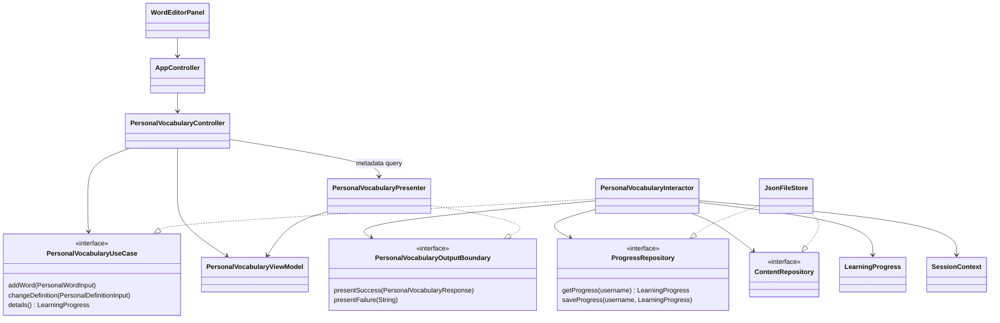

# Allen's UC-08 presentation and rehearsal guide

This guide describes the implemented personal-vocabulary flow at delivery commit
`3f4b4f3`. It is a script to rehearse, not a record of a completed live
demonstration or a personal reflection. The original implementation and review
are in [PR #3](https://github.com/fanfan170721/team-project/pull/3).

## Prepare before starting the presentation clock

1. Follow [Demo preparation](DEMO_PREPARATION.md) to build the JAR and generate
   a new `.wordtrail/rehearsal-01` profile. The helper prepares synthetic
   `demo_admin`, `demo_allen` and `demo_guest` accounts before presenting.
   It refuses existing directories; use a new name for another rehearsal.
2. When ready to open a window, start from the project root:

   ```powershell
   java -jar target/wordtrail.jar --data-dir .wordtrail/rehearsal-01
   ```

3. Log in as `demo_allen`, password `WordTrailDemo123!`. Leave **Vocabulary**
   visible. The fresh profile does not contain `serendipity` in `My words`.
   The existing `Demo` topic belongs to the other planned demonstrations;
   keep this live addition in `My words` so it does not change their plan.
4. Have the two diagrams below and the interactor source ready. Reopen using:

   ```powershell
   java -jar target/wordtrail.jar --data-dir .wordtrail/rehearsal-01
   ```

   Reuse exactly the same directory. Close the first application before opening
   another instance because the store locks its data directory. This guide does
   not launch the application or play audio automatically.

## Three-to-four-minute talk track with exact actions

The timings are rehearsal targets, not measured completion times. Prepare the
accounts beforehand. Explain the diagrams while the application reloads if
necessary; leave detailed test inspection for questions.

| Time | Do this | Suggested words and observable result |
| --- | --- | --- |
| 0:00–0:20 | Point to **Vocabulary**. | “UC-08 lets a learner add a private word and customize a definition without changing another learner's vocabulary. The signed-in account determines ownership.” |
| 0:20–0:45 | Click **Add my word**. Leave **Word** empty. Enter **Topic (existing or new)** = `My words`, **My definition** = `A fortunate discovery.`, and **Example (for new words)** = `A moment of serendipity.` Leave Source at its default. Click **Save**. | “Validation is enforced in the use case. This missing word produces `Word is required.` The editor stays open and retains the topic, definition and example so I can correct the input.” |
| 0:45–1:05 | Fill **Word** with `serendipity`; click **Save**. Wait for the vocabulary table and completion message. | “A successful save returns to the list, resets its topic/search filters, selects the saved word and scrolls it into view. The message is `Added "serendipity" to your vocabulary.` Success is reported only after persistence succeeds.” |
| 1:05–1:25 | With that row selected, click **Edit my definition**. Replace the meaning with `My own lucky discovery.` and click **Save**. | “Editing changes only this account's definition. Word, topic, example and source are read-only in this mode. The saved row now displays the revised meaning and an update confirmation.” |
| 1:25–1:55 | Choose **Log out**; log in as `demo_guest` with the same demo password. In Vocabulary's search field enter `serendipity` and click **Search**. | “The other account sees no matching row because this personal word is not part of its visible vocabulary. The interactor obtains the username from `SessionContext`, not from an editable username in the save request.” |
| 1:55–2:20 | Close WordTrail. Run the reopen command above with the same directory. Log in as `demo_allen`, search for `serendipity`, and select it. | “The word and `My own lucky discovery.` survive reopening. This is persisted account data, not merely a row left in Swing memory.” |
| 2:20–3:15 | Show the dependency and sequence diagrams; point to `saveProgress` and the subsequent `presentSuccess` in the interactor. | “The view captures text on Swing's event thread. `UiTasks` runs the command in a background worker. The dedicated controller creates an input DTO; the interactor applies policy through repository interfaces. Its output boundary calls the presenter, which creates an immutable result. Back on the event thread, a successful result starts a second background worker to reload Vocabulary. Only that second callback rebuilds and selects the table row.” |
| 3:15–3:50 | Point to the SOLID and pattern examples below. | “Policy, storage and Swing have separate responsibilities, and core policy depends on interfaces rather than the file store. The live-dictionary provider strategies and fallback wrapper give a separate, implemented extension example. The remaining hybrid read-response flow and whole-file storage are tradeoffs I can explain.” |

If a step fails, describe the actual result rather than reading the success line.
For an additional error-path demonstration, edit the definition to one space and
save: `Definition is required.` appears, the editor retains the space, and the
previous saved meaning remains unchanged. Enter a valid meaning to recover.

## Dependency diagram: source-code dependencies



The dashed inheritance arrows mean “implements”; ordinary arrows mean “depends
on.” The interactor does not depend on Swing, JSON, the concrete presenter or the
view model. [Application](../src/main/java/com/wordtrail/app/Application.java)
constructs and injects the concrete objects; the composition root is intentionally
outside this simplified diagram. Input DTOs carry unvalidated text. The output
DTO carries the committed operation, word ID, term and definition, not repository
objects.

## Sequence diagram: two asynchronous stages after a successful save

```mermaid
sequenceDiagram
    actor Learner
    participant E as WordEditorPanel (EDT)
    participant U as UiTasks / SwingWorker
    participant C as AppController + PersonalVocabularyController
    participant I as PersonalVocabularyInteractor
    participant R as ProgressRepository / JsonFileStore
    participant P as PersonalVocabularyPresenter
    participant M as PersonalVocabularyViewModel
    participant L as LibraryPanel (EDT)
    participant B as AppController + CatalogController

    Learner->>E: Click Save
    E->>E: Capture form text and selected word on EDT
    E->>U: run(save supplier, result callback)
    U->>U: Capture/disable controls on EDT
    Note over U,C: First worker: doInBackground
    U->>C: addPersonalWord(...) or changeDefinition(...)
    C->>M: beginRequest() clears previous result
    C->>I: addWord(input DTO) or changeDefinition(input DTO)
    I->>I: Require signed-in account
    I->>R: getProgress(account)
    R-->>I: Immutable current snapshot
    I->>I: Validate input and visible vocabulary
    alt Valid command and successful persistence
        I->>R: saveProgress(account, new snapshot)
        R-->>I: Save completes
        I->>P: presentSuccess(response) through output boundary
        P->>M: complete(immutable successful SaveResult)
    else Expected validation/read/write AppException
        I->>P: presentFailure(message) through output boundary
        P->>M: complete(failed SaveResult with no previous word)
    end
    I-->>C: Command returns
    C->>M: result()
    M-->>C: This request's SaveResult
    C-->>U: SaveResult
    Note over U,E: First done() runs on EDT; restore controls and clear busy
    U->>E: Invoke result callback
    alt Result reports failure
        E->>U: message(error); keep editor and its input
    else Result reports success
        E->>L: onSaved(result)
        L->>L: Show list; reset topic/search filters
        L->>U: run(Loading vocabulary, list callback)
        Note over U,B: Second worker: doInBackground
        U->>B: browse(topic, search)
        B->>B: Read current visible words and personal metadata; present Library
        B-->>U: Library display model
        Note over U,L: Second done() runs on EDT
        U->>L: Rebuild rows; select and scroll to saved word ID
        L->>U: message(original save confirmation)
    end
```

For legibility, thin facade calls are grouped with their feature controller.
The diagram shows the Vocabulary editor; the same editor can also be opened
from **Review later**, whose refresh uses `reviewList()` instead of `browse()`.
`UiTasks` restores controls and clears its busy flag before invoking the callback,
which is why the successful-save callback can start the second worker. A failure
in that reload does not undo the already persisted save. Unexpected exceptions
are handled by `UiTasks` and are not ordinary failed `SaveResult` objects.

## Two concrete SOLID examples

1. **Dependency inversion:** `PersonalVocabularyInteractor` depends on the
   use-case-layer `ProgressRepository`, `ContentRepository` and output boundary.
   [JsonFileStore](../src/main/java/com/wordtrail/data/JsonFileStore.java) and
   [PersonalVocabularyPresenter](../src/main/java/com/wordtrail/adapter/PersonalVocabularyPresenter.java)
   implement those outward-facing capabilities. Replacing file persistence with
   another implementation of the same contracts changes composition, not the
   UC-08 validation rules. Memory repository doubles already exercise this seam
   in the interactor tests; an SQL adapter is a possible extension, not an
   implemented feature.
2. **Single responsibility:**
   [PersonalVocabularyInteractor](../src/main/java/com/wordtrail/usecase/PersonalVocabularyInteractor.java)
   decides required fields, duplicate policy, account ownership and when to save;
   the presenter formats `Added ...` / `Updated ...` messages;
   [WordEditorPanel](../src/main/java/com/wordtrail/view/WordEditorPanel.java) owns
   editable controls; the store owns serialization and replacement of the data
   file. Changing confirmation wording does not require changing persistence.
   The presenter also formats personal progress metadata, so describe its
   responsibility as personal-vocabulary presentation rather than claiming one
   method per class or perfect isolation everywhere.

## A concrete pattern beyond the basic controller/presenter chain

**Strategy with fallback composition** is implemented for live lookup, including
the editor's **Fill from online dictionary** action. The
[DictionaryGateway](../src/main/java/com/wordtrail/usecase/port/DictionaryGateway.java)
interface permits interchangeable providers. `DictionaryApiClient` and
`DatamuseDictionaryClient` implement it; the
[ResilientDictionaryGateway](../src/main/java/com/wordtrail/data/ResilientDictionaryGateway.java)
wrapper also implements it and accepts two gateways in its constructor.

The wrapper returns the primary result, tries the backup on an `AppException`
unless the thread is interrupted, and preserves the actual provider source.
If both fail, it reports failure instead of labeling local seed data as online.
The concrete extension seam is the constructor's two `DictionaryGateway`
arguments: a third provider implementation can be substituted at composition
without changing the catalog use case or editor. The current wrapper has two
slots; an arbitrary provider list or caching layer is not implemented.

This is separate from saving a word: **Save** does not call the network. Online
lookup fills editor fields; persistence still requires **Save**. The proposed
UC-08 rehearsal above therefore works offline. A live API demonstration, if
included in the team's presentation, must show its actual result and source.
Use this concrete code example rather than asserting that naming a pattern alone
meets a rubric category or that it is absent from every course starter example.

## Source and automated evidence to open during questions

| Question or behavior | Source or named test |
| --- | --- |
| Where do form values enter the use case? | [WordEditorPanel](../src/main/java/com/wordtrail/view/WordEditorPanel.java), [PersonalVocabularyController](../src/main/java/com/wordtrail/adapter/PersonalVocabularyController.java), [PersonalWordInput](../src/main/java/com/wordtrail/usecase/PersonalWordInput.java), [PersonalDefinitionInput](../src/main/java/com/wordtrail/usecase/PersonalDefinitionInput.java). |
| Is success reported after the write? | [PersonalVocabularyBoundaryTest](../src/test/java/com/wordtrail/usecase/PersonalVocabularyBoundaryTest.java): `eachSuccessIsPresentedExactlyOnceAfterItsSaveAndContainsCommittedValues`; `presenterFailuresAreNotMisreportedAsBusinessFailuresOrRetried`. |
| Can a failure reuse an earlier success? | [PersonalVocabularyAdaptersTest](../src/test/java/com/wordtrail/adapter/PersonalVocabularyAdaptersTest.java): `failedRequestReplacesSuccessWithoutLeakingThePreviousWord`; `missingOutputCannotReuseAnEarlierSuccessfulResult`. |
| Does invalid input remain editable, and does the saved row become visible? | [SwingWorkflowTest](../src/test/java/com/wordtrail/view/SwingWorkflowTest.java): `personalSaveFailuresPreserveInputAndSuccessSelectsTheSavedWord`. It checks retained form values, the failure message, persisted unchanged meaning, selection and scrolling. |
| Are personal data and overrides private, including a direct attempt to edit another account's word ID? | [PersonalVocabularyInteractorTest](../src/test/java/com/wordtrail/usecase/PersonalVocabularyInteractorTest.java): `personalWordsAndDefinitionsArePrivateAndIntegratedIntoLearning`. |
| Does the flow survive reopening? | [SwingWorkflowTest](../src/test/java/com/wordtrail/view/SwingWorkflowTest.java): `personalEditingReviewCountsSortingAndQuizWorkForLearnersAndPersist`, which closes/reopens the real JSON-backed application and switches accounts. |
| Do failed writes preserve the earlier state? | [PersonalVocabularyInteractorTest](../src/test/java/com/wordtrail/usecase/PersonalVocabularyInteractorTest.java): `invalidOrDuplicateWordsAndFailedWritesDoNotPartiallySave`; [LearningProgress](../src/main/java/com/wordtrail/entity/LearningProgress.java) returns new snapshots. |
| Where does the second worker start? | [LibraryPanel](../src/main/java/com/wordtrail/view/LibraryPanel.java): the editor's `onSaved` callback calls `refresh(wordId, message)`; [UiTasks](../src/main/java/com/wordtrail/view/UiTasks.java) invokes its completion callback on the EDT. |
| Are dependency rules checked? | [ArchitectureTest](../src/test/java/com/wordtrail/ArchitectureTest.java): `businessLayersDoNotDependOnDeliveryOrInfrastructure`; `swingViewsDependOnlyOnDisplayAdapters`. These inspect source dependencies, not every possible architectural concern. |
| Is fallback behavior tested without relying on a live service? | [ResilientDictionaryGatewayTest](../src/test/java/com/wordtrail/data/ResilientDictionaryGatewayTest.java): `preservesPrimaryResultWithoutContactingBackup`; `primary530UsesAnotherLiveProviderAndPreservesItsSource`; `bothFailuresAreReportedWithoutClaimingLocalDataIsOnline`. |

The Swing tests use real Swing components headlessly, temporary data directories
and a fake dictionary. They establish automated behavior, not a completed native
desktop rehearsal or a successful live HTTP request. To inspect these cases,
run the named test classes with Maven's `-Dtest` option; run `mvn verify` for the
full project's tests, coverage gate and reports.

## Five likely TA questions

1. **Why are there both an output boundary and a return value?**
   The interactor reports a command outcome through the output boundary. The
   presenter writes an immutable `SaveResult` into its view model; the controller
   returns that snapshot to the worker, whose callback runs on the EDT. This is
   a hybrid synchronous output-port/return-value adapter design, not an
   observer-driven view model. The `details()` metadata query still returns a
   `LearningProgress` snapshot to the adapter, and several older read flows use
   direct return-value responses.
2. **Why is the username absent from the add/edit input DTO?**
   Ownership comes from the authenticated session. The interactor reads and
   saves that username's progress and requires an edited word to be visible to
   that account. A caller cannot pick another owner just by changing a form
   field. This is application-level isolation, not protection against the local
   desktop user directly editing the JSON file.
3. **What happens if the file write or the presenter fails?**
   An expected storage `AppException` produces a failure output and the old
   progress remains unchanged. The presenter is called after the save and
   outside that catch block; a presenter failure is not relabeled as a failed
   write or retried. The UI reports the unexpected error; after refreshing, the
   already saved value may be visible.
4. **Why use immutable snapshots and clear the result before each request?**
   `withPersonalWord` / `withDefinition` create new progress rather than mutating
   the old value before persistence. `beginRequest()` prevents a missing output
   from reusing a previous success; `result()` throws if no response was
   produced. The final-field display result crosses from worker to EDT without
   exposing an entity or store to the view.
5. **What would you improve next, and what would it change?**
   The store rewrites one JSON document and has no cross-device synchronization.
   A more scalable repository could preserve the existing use-case ports, with
   new adapter/integration tests. Separately, replacing the metadata return with
   a dedicated display-oriented boundary would reduce the remaining adapter-to-
   entity coupling. Neither change is claimed as already implemented.
