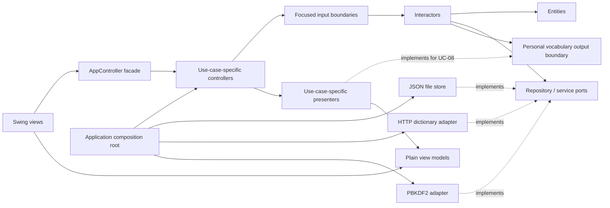
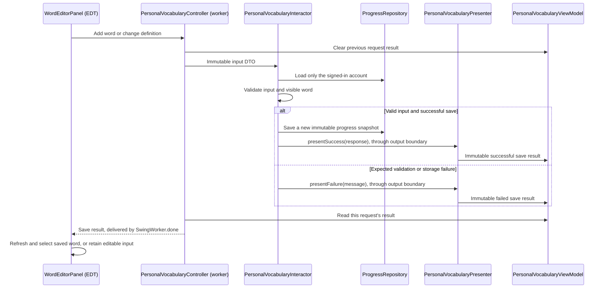

# Architecture and design rationale

## Dependency direction



Runtime calls reach outer adapters through interfaces declared in the use-case
layer. Source dependencies point inward. The composition root is the deliberate
exception that knows the concrete implementations.

| Package | Responsibility | Allowed project dependencies |
| --- | --- | --- |
| `entity` | Immutable user, word, question, attempt and progress objects | None |
| `usecase` | Application policies, session, input boundaries and ports | `entity` |
| `data` | JSON, password hashing and public HTTP API implementations | `entity`, `usecase` |
| `adapter` | Specific controllers/presenters translate requests and format responses; facade preserves UI API | `entity`, `usecase` |
| `view` | Swing components, event handlers, background UI tasks | `adapter` |
| `app` | Composition and desktop launch | All outer layers |

The source-level architecture tests reject Swing, HTTP or JSON imports in the
business layers, and reject direct core/infrastructure imports in the views.

## Story boundaries

Each existing story has an input interface, an interactor and a dedicated
controller/presenter pair. An input interface can be replaced by a test double
without changing the controller. `AppController` is only a Swing-facing facade;
it delegates to the specific controllers instead of owning presentation logic.

| Story | Input boundary / implementation | Outbound ports |
| --- | --- | --- |
| Accounts | `AuthUseCase` / `AuthInteractor` | `AccountRepository`, `PasswordHasher` |
| Vocabulary | `CatalogUseCase` / `CatalogInteractor` | `ContentRepository`, `DictionaryGateway` |
| Flashcards | `FlashcardUseCase` / `FlashcardInteractor` | `ContentRepository`, `ProgressRepository` |
| Quiz | `QuizUseCase` / `QuizInteractor` | `ContentRepository`, `ProgressRepository` |
| Review list | `ReviewUseCase` / `ReviewInteractor` | `ContentRepository`, `ProgressRepository` |
| Progress | `ProgressUseCase` / `ProgressInteractor` | `ContentRepository`, `ProgressRepository` |
| Admin | `ContentUseCase` / `ContentInteractor` | `ContentRepository` |
| Personal vocabulary | `PersonalVocabularyUseCase` / `PersonalVocabularyInteractor` | `ContentRepository`, `ProgressRepository`, `PersonalVocabularyOutputBoundary` |

The controller/presenter prefixes are `Auth`, `Catalog`, `Flashcard`, `Quiz`,
`Review`, `Progress`, `Content` and `PersonalVocabulary`. Their roles are concrete:
for example, FlashcardPresenter hides unrevealed definitions, QuizPresenter formats
answer feedback, and ProgressPresenter formats dated histories and summary views.
PersonalVocabularyPresenter implements the personal-edit output boundary, turning
persisted successes or expected failures into a dedicated immutable save result.
It also formats account-specific display metadata; catalog, review and content
controllers obtain fresh metadata for their own output.
Shared `WordDisplay` maps one vocabulary row, while `ControllerCalls` translates
expected application errors into display errors. Neither owns the use cases.

The existing read/learning flows use return-value responses: the controller calls
the presenter with the interactor's result. Personal vocabulary edits use an
explicit output port and request/response DTOs as detailed below. The lightweight
`details()` metadata query still returns an immutable `LearningProgress` snapshot
to the adapter, never to a Swing view. This is a deliberate remaining coupling;
the project does not claim every existing use case has been converted to output ports.

## UC-08: personal vocabulary edit flow



`PersonalWordInput` and `PersonalDefinitionInput` carry the submitted text.
`PersonalVocabularyResponse` contains only the operation, word ID, term and saved
definition. The interactor calls the output port after persistence succeeds; an
expected failure produces one failure response and no success notification.
Presenter failures are outside the interactor's storage/validation catch block,
so a display failure cannot be misreported as a failed save.

The presenter depends on the core output interface, while the interactor does
not import the presenter or view model. `Application` supplies the implementation.
The controller serializes its synchronous edit requests and clears the previous
result first. A use-case implementation that omits its output fails explicitly
instead of reusing stale success. `UiTasks` delivers the immutable result to the
EDT. Failed saves keep the editor and its text available for correction; successful
saves refresh the list, select the saved word, and display the presenter's message.

## Entities and state

- `User`: canonical username, encoded password hash and role.
- `VocabularyWord`: stable ID, term, topic, definition, optional example, source.
- `QuizQuestion`: stable ID, associated word ID, prompt, four choices, correct index.
- `QuizAttempt`: completion instant, topic label, number correct and total.
- `LearningProgress`: saved word IDs, distinct studied IDs by local date, attempts,
  personal words, per-word definition overrides, review counts and last-review instants.

Progress snapshots are immutable and defensively copied. A transformation returns
a new object; a failed disk write does not mutate the previous snapshot. Content
from the admin bank is shared, while progress and personal vocabulary are indexed
by authenticated username. `ContentQueries` merges the shared bank with only the
current account's words and applies that account's definition overrides. There is no word
deletion yet, so historical word IDs remain resolvable.

`SessionContext` is in memory and never persisted. Every successful sign-in and
logout increments its version. Decks and quizzes require the version on which
they were created, preventing an unfinished session being continued by a
different account or after logging out and back in.

## Patterns used for concrete reasons

- **Repository:** account, content and progress interfaces hide JSON. An SQL
  implementation can replace the file adapter.
- **Adapter:** `DictionaryApiClient` translates HTTP/JSON into a small dictionary
  response. The specific controllers and presenters adapt application input/output.
- **Composite/decorator:** `ResilientDictionaryGateway` composes the primary and
  Datamuse adapters. It tries another live provider on failure and preserves the
  provider's source; it never labels local seed text as an online result.
- **Strategy:** `PasswordHasher` permits changing the hashing implementation.
  `DictionaryGateway` permits a different dictionary provider.
- **Dependency injection:** `Application` passes ports, `Clock`, and `Random`
  into interactors. Tests supply fixed clocks and deterministic randomness.
- **MVP-style separation:** passive Swing views consume plain view models and
  send actions to the controller. Presentation formatting has no Swing dependency.

No singleton, service locator, or global repository is needed.

## SOLID examples

**Single responsibility:** hashing, network parsing, account policies, formatting
and Swing painting have separate classes. One interactor owns each requested
story.

**Open/closed:** dictionary providers and storage implementations can be changed
through their ports. Adding a new screen need not modify entities.

**Liskov substitution:** repository doubles and the real store obey the same
contracts. Business tests use a memory store; workflow tests use the JSON store.

**Interface segregation:** account callers do not depend on content/progress
methods; each story has a focused input boundary.

**Dependency inversion:** interactors depend on ports in `usecase.port`, never on
the concrete file store, JSON library or HTTP client.

## Persistence and failures

A schema-versioned JSON document stores:

```text
schemaVersion: 1
users: [{username, passwordHash, role}]
words: [{id, term, topic, definition, example, source}]
questions: [{id, wordId, prompt, options[4], correctIndex}]
progress: {username: {reviewWordIds[], studyDays: {YYYY-MM-DD: [wordId]}, attempts[],
  personalWords[], definitions: {wordId: text}, reviewCounts: {wordId: integer},
  lastReviewed: {wordId: ISO-instant}}}
```

The adapter copies the current JSON, applies a mutation, writes a temporary file
in the same directory, flushes the channel and replaces the saved file. It only
publishes the new in-memory snapshot after the write succeeds. Atomic replacement
is used where supported; the fallback replacement has weaker crash guarantees.
This is suitable for a small local app, not a general transactional database.

The new progress fields are optional when reading version-1 files and are written
on the next update. Missing counts default to zero; old daily study sets remain
unchanged. Counts are not guessed from incomplete historical data. Reference
validation accepts the account's personal IDs and rejects unrelated IDs.

An OS file lock covers the lifetime of the application. It prevents concurrent
instances from using one directory; synchronized repository methods protect
in-process access. Corrupt or unsupported files cause a startup error and are
preserved. Backups are manual. There is no cross-device synchronization.

A completed quiz writes exactly one attempt. If the final save fails, the selected
answer and score do not advance, so retry is safe. Duplicate submissions are
rejected. Abandoned quizzes and unrevealed cards do not increase progress.

A completed flashcard review increments the word count and records an instant,
while its daily studied-word set remains deduplicated. Each card visit has a
completion flag, so repeated submissions cannot inflate the count. Moving to
another card resets that flag and allows another intentional review. Failed writes
leave the visit uncompleted, allowing retry.

New quizzes keep unmodified admin-authored questions. Personal words and overridden
definitions generate definition questions with three distinct distractors sampled
from the visible vocabulary, followed by shuffled choices with a remapped correct
index. Existing in-progress quizzes retain their start-time snapshot.

## Authentication and authorization

First-run setup is available only while there are no accounts. It creates one
administrator; ordinary registration always creates a learner. Both roles can
learn. Admin content mutations check the role in the interactor as well as hiding
the tab in the GUI.

Passwords use PBKDF2-HMAC-SHA256, 210,000 iterations, a random 16-byte salt, and a
256-bit result. Encoded hashes carry their algorithm and iteration count.
Comparison uses `MessageDigest.isEqual`. Password character arrays are cleared
after authentication attempts. The application sends only a queried word to the
dictionary API, never usernames or passwords.

The data file is controlled by the desktop user. This role system is not a
security boundary against someone editing their own file. There is no remote
authentication server, account recovery or production account lockout policy.

## Threading

Swing components are created/updated on the Event Dispatch Thread. `UiTasks`
serializes controller work in `SwingWorker.doInBackground` and restores each
control's original enabled state before applying the result on the EDT.
All component states are captured before any parent is disabled, because some
Swing parents propagate enabled changes to children.

Dictionary connections have a four-second connect timeout and requests have an
eight-second timeout. HTTP 404, 429, other error statuses, interruption, network
failures and malformed JSON trigger an attempt against the backup live provider.
Both providers have bounded requests (up to eight seconds each), so an unsuccessful
two-provider lookup can take up to roughly sixteen seconds. Results show the actual
provider URL. Both failures produce a user-facing error and preserve the saved
definition. The chart and local study features do not require networking.

## UC-09 core integration status

Fuxuan's PR #4 adds `ExportResultsInputBoundary`, `ExportResultsInteractor`,
`ExportResultsOutputBoundary`, response/row DTOs and the `QuizResultsExporter`
port. The core uses the current session, reads that account's completed quizzes,
sorts a copy oldest-first and calls the exporter before reporting success. It
does not write files, change learning progress or reference Swing.

The eight behavior tests use a fake exporter. A concrete CSV adapter, dedicated
Controller/Presenter/ViewModel, triggering/result UI and application wiring are
still pending. This core is merged but cannot yet be invoked from a screen.
The proposed CSV handoff to Allen is on hold awaiting Fuxuan's reply.

## Tradeoffs to discuss in the presentation

The whole JSON file is rewritten for each change, which keeps updates easy to
reason about but will not scale to large histories. The Swing-facing facade
preserves a small view API while delegating to feature adapters. Several existing
read/learning interactors return entities; UC-08 edits now use dedicated input/output
DTOs and an output port. Native Swing appearance is intentionally simple.
