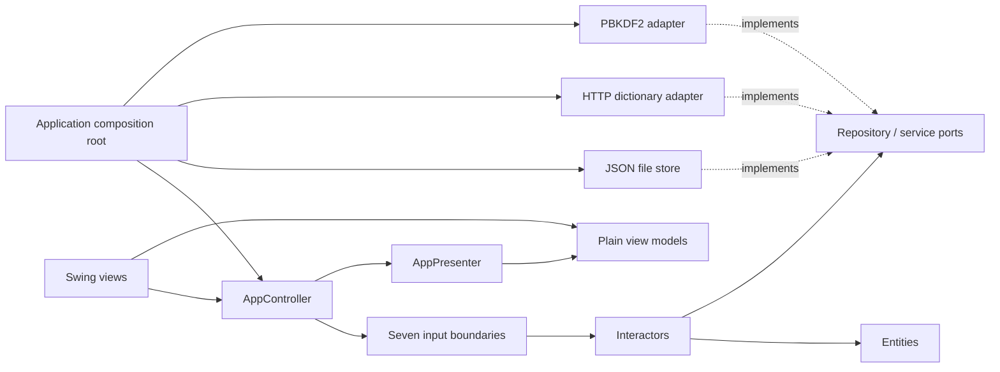

# Architecture and design rationale

## Dependency direction



Runtime calls reach outer adapters through interfaces declared in the use-case
layer. Source dependencies point inward. The composition root is the deliberate
exception that knows the concrete implementations.

| Package | Responsibility | Allowed project dependencies |
| --- | --- | --- |
| `entity` | Immutable user, word, question, attempt and progress objects | None |
| `usecase` | Application policies, session, input boundaries and ports | `entity` |
| `data` | JSON, password hashing and public HTTP API implementations | `entity`, `usecase` |
| `adapter` | Translate UI requests and format use-case responses | `entity`, `usecase` |
| `view` | Swing components, event handlers, background UI tasks | `adapter` |
| `app` | Composition and desktop launch | All outer layers |

The source-level architecture tests reject Swing, HTTP or JSON imports in the
business layers, and reject direct core/infrastructure imports in the views.

## Story boundaries

Each story has an input interface and an interactor. An interface can be replaced
by a test double without changing the controller.

| Story | Input boundary / implementation | Outbound ports |
| --- | --- | --- |
| Accounts | `AuthUseCase` / `AuthInteractor` | `AccountRepository`, `PasswordHasher` |
| Vocabulary | `CatalogUseCase` / `CatalogInteractor` | `ContentRepository`, `DictionaryGateway` |
| Flashcards | `FlashcardUseCase` / `FlashcardInteractor` | `ContentRepository`, `ProgressRepository` |
| Quiz | `QuizUseCase` / `QuizInteractor` | `ContentRepository`, `ProgressRepository` |
| Review list | `ReviewUseCase` / `ReviewInteractor` | `ContentRepository`, `ProgressRepository` |
| Progress | `ProgressUseCase` / `ProgressInteractor` | `ContentRepository`, `ProgressRepository` |
| Admin | `ContentUseCase` / `ContentInteractor` | `ContentRepository` |

This is a small Clean Architecture implementation with return-value response
models. Interactors return responses to the controller, which invokes the
presenter. It does not introduce a separate output callback interface per use
case. That keeps the initial classroom app smaller; output ports could be added
if multiple asynchronous delivery mechanisms require them.

## Entities and state

- `User`: canonical username, encoded password hash and role.
- `VocabularyWord`: stable ID, term, topic, definition, optional example, source.
- `QuizQuestion`: stable ID, associated word ID, prompt, four choices, correct index.
- `QuizAttempt`: completion instant, topic label, number correct and total.
- `LearningProgress`: saved word IDs, distinct studied IDs by local date, attempts.

Progress snapshots are immutable and defensively copied. A transformation returns
a new object; a failed disk write does not mutate the previous snapshot. Content
is shared, while progress is indexed by authenticated username. There is no word
deletion yet, so historical word IDs remain resolvable.

`SessionContext` is in memory and never persisted. Every successful sign-in and
logout increments its version. Decks and quizzes require the version on which
they were created, preventing an unfinished session being continued by a
different account or after logging out and back in.

## Patterns used for concrete reasons

- **Repository:** account, content and progress interfaces hide JSON. An SQL
  implementation can replace the file adapter.
- **Adapter:** `DictionaryApiClient` translates HTTP/JSON into a small dictionary
  response. `AppController` and `AppPresenter` adapt application input/output.
- **Strategy:** `PasswordHasher` permits changing the hashing implementation.
  `DictionaryGateway` permits a different dictionary provider.
- **Dependency injection:** `Application` passes ports, `Clock`, and `Random`
  into interactors. Tests supply fixed clocks and deterministic randomness.
- **MVP-style separation:** passive Swing views consume plain view models and
  send actions to the controller. Presentation formatting has no Swing dependency.

No singleton, service locator, or global repository is needed.

## SOLID examples

**Single responsibility:** hashing, network parsing, account policies, formatting
and Swing painting have separate classes. One interactor owns each requested
story.

**Open/closed:** dictionary providers and storage implementations can be changed
through their ports. Adding a new screen need not modify entities.

**Liskov substitution:** repository doubles and the real store obey the same
contracts. Business tests use a memory store; workflow tests use the JSON store.

**Interface segregation:** account callers do not depend on content/progress
methods; each story has a focused input boundary.

**Dependency inversion:** interactors depend on ports in `usecase.port`, never on
the concrete file store, JSON library or HTTP client.

## Persistence and failures

A schema-versioned JSON document stores:

```text
schemaVersion: 1
users: [{username, passwordHash, role}]
words: [{id, term, topic, definition, example, source}]
questions: [{id, wordId, prompt, options[4], correctIndex}]
progress: {username: {reviewWordIds[], studyDays: {YYYY-MM-DD: [wordId]}, attempts[]}}
```

The adapter copies the current JSON, applies a mutation, writes a temporary file
in the same directory, flushes the channel and replaces the saved file. It only
publishes the new in-memory snapshot after the write succeeds. Atomic replacement
is used where supported; the fallback replacement has weaker crash guarantees.
This is suitable for a small local app, not a general transactional database.

An OS file lock covers the lifetime of the application. It prevents concurrent
instances from using one directory; synchronized repository methods protect
in-process access. Corrupt or unsupported files cause a startup error and are
preserved. Backups are manual. There is no cross-device synchronization.

A completed quiz writes exactly one attempt. If the final save fails, the selected
answer and score do not advance, so retry is safe. Duplicate submissions are
rejected. Abandoned quizzes and unrevealed cards do not increase progress.

## Authentication and authorization

First-run setup is available only while there are no accounts. It creates one
administrator; ordinary registration always creates a learner. Both roles can
learn. Admin content mutations check the role in the interactor as well as hiding
the tab in the GUI.

Passwords use PBKDF2-HMAC-SHA256, 210,000 iterations, a random 16-byte salt, and a
256-bit result. Encoded hashes carry their algorithm and iteration count.
Comparison uses `MessageDigest.isEqual`. Password character arrays are cleared
after authentication attempts. The application sends only a queried word to the
dictionary API, never usernames or passwords.

The data file is controlled by the desktop user. This role system is not a
security boundary against someone editing their own file. There is no remote
authentication server, account recovery or production account lockout policy.

## Threading

Swing components are created/updated on the Event Dispatch Thread. `UiTasks`
serializes controller work in `SwingWorker.doInBackground` and restores each
control's original enabled state before applying the result on the EDT.
All component states are captured before any parent is disabled, because some
Swing parents propagate enabled changes to children.

Dictionary connections have a four-second connect timeout and requests have an
eight-second timeout. HTTP 404, 429, other error statuses, interruption, network
failures and malformed JSON produce user-facing errors. There is no silent API
fallback. The chart and local study features do not require networking.

## Tradeoffs to discuss in the presentation

The whole JSON file is rewritten for each change, which keeps updates easy to
reason about but will not scale to large histories. One shared controller and
presenter are convenient now but may later split by feature. Interactors currently
return some entities; dedicated output DTOs and output ports would further isolate
the boundaries if the app grows. Native Swing appearance is intentionally simple.
