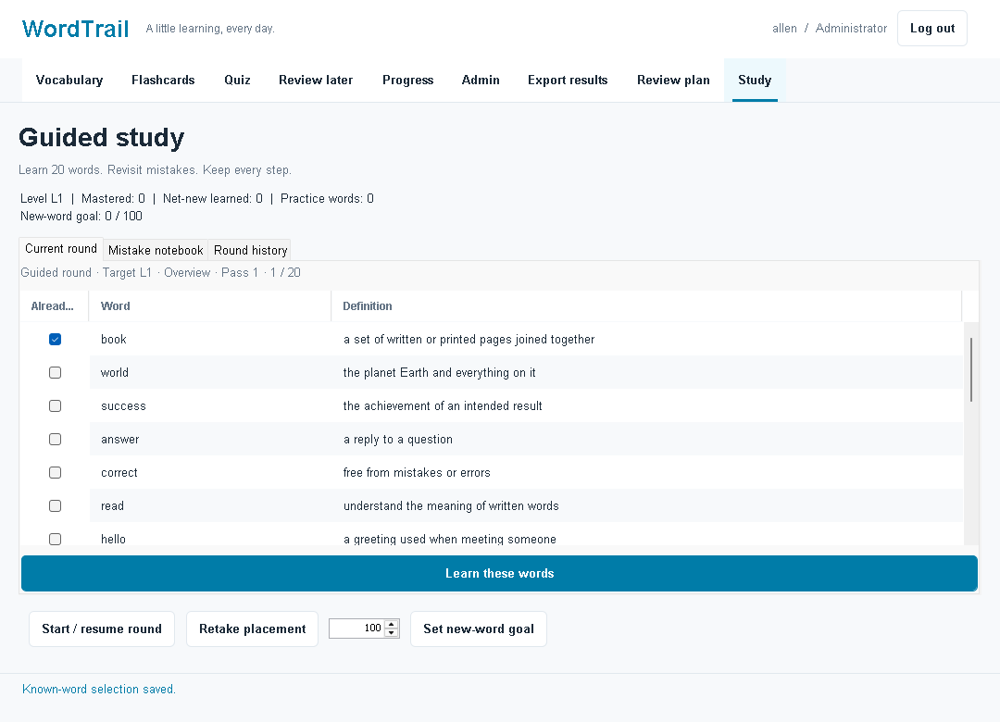
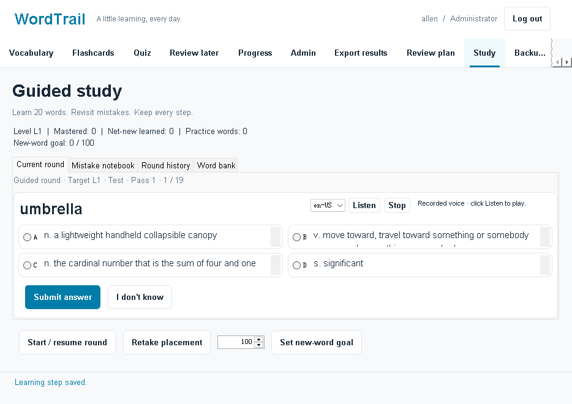

# Guided study: restore the complete learning loop

The `Study` tab is the primary route for learning a complete round of 20 words.
Vocabulary, Flashcards and Quiz remain available for browsing and free practice.
This supporting extension is led by Zidong Yuan; it does not replace the existing
UC-09/UC-10 ownership or claim another member's review.

## User story

As a learner, I want to work through a manageable round, revisit words I miss,
and resume where I stopped so that completion reflects learning rather than
merely answering some questions.

## UC-11: Complete a guided vocabulary round

- **Primary actor:** Signed-in learner.
- **Preconditions:** A valid local account and the bundled sample curriculum.
- **Trigger:** The learner starts or resumes guided study.
- **Success outcome:** All 20 words are mastered; only newly learned words advance
  the goal, and completion/history are recorded exactly once.
- **Main success scenario:**
  1. The system restores unfinished work or selects 20 distinct words, preferring
     unmastered vocabulary near the learner's target level.
  2. The learner reviews the overview and marks words they already know.
  3. The learner studies the remaining meanings, then answers four-choice questions
     or explicitly chooses **I don't know**.
  4. The system saves every action, including the exact question and option order.
  5. The learner relearns and retests only incorrect/unknown words, using the
     original options, until every remaining word is answered correctly.
  6. The system records mastery, net-new progress, practice totals and history
     together. Learned content joins private vocabulary, review dates and quiz
     history; words ever missed also join Review later. CSV export includes the
     completed first-pass score, including words declared already known.
- **Extensions:**
  - At 2, declaring all words already known completes the round with zero net-new
    words. If 5 were known and 15 were newly learned, mastery increases by 20 and
    net-new learning by 15.
  - At 3–5, closing/reopening or logging out preserves the current step. A stale
    question token cannot submit an answer to a newer round or another account.
  - At 4–6, a failed write leaves the previous state intact and allows retry. No
    success is presented and no partial completion is counted.
  - After completion, replaying history uses the saved original questions and
    creates a separate history entry without increasing mastery, goals, practice
    totals or exported quiz-completion counts.
  - Invalid goals, answer selections and out-of-date screens report a useful error.

## UC-12: Reassess and immediately start at the recommended level

- **Primary actor:** Signed-in learner.
- **Preconditions:** The sample curriculum is available; an existing study round
  may be unfinished.
- **Trigger:** The learner chooses **Retake placement**.
- **Success outcome:** Explicitly adopting a completed result opens a fresh
  20-word round immediately while preserving completed learning and the goal.
- **Main success scenario:**
  1. The learner answers a balanced 20-question sample across L1–L3.
  2. Each answer is saved; an interrupted assessment resumes unchanged.
  3. The system displays the score and recommended sample level.
  4. The learner selects **Apply level and start fresh 20 words**, after seeing
     that unfinished work will be replaced without completion credit.
  5. The system archives unfinished work as replaced, applies the level and creates
     the new round in one durable update.
- **Extensions:** Incomplete results cannot be adopted. Reapplying the same result
  does not create another round. A failed save preserves the original round.

The sample bank has **60 English words, 20 per level**. These are not CEFR levels,
a calibrated vocabulary-size estimate, a complete exam list or Python's larger
15-level curriculum. A replacement round can contain previously seen words.
Normal new rounds prefer unseen words even when this requires a nearby level.

## Persistence and architecture

`StudyController` calls a dedicated input boundary. `StudyInteractor` owns the
learning rules and presents through `StudyOutputBoundary` / `StudyPresenter`.
The Swing view receives display models only. `StudyRepository` is implemented by
the existing atomic JSON store, so guided state and shared completion records
commit together under its existing process lock.

Old profiles load without being rewritten merely to open them. The optional,
versioned guided-study section is validated, and corrupt original files are
preserved. Private definition edits affect newly created questions; active rounds
and replays retain their original snapshots. No native playback is triggered.

## Validation — November 28, 2026

- Maven `verify`: **167 tests**, no failures, errors or skips.
- Entity and Use Case line coverage: **882/882 (100%)**, with the existing gate retained.
- Real JSON tests cover restart, account isolation, failed-save retry, exact
  snapshot recovery, persistent mistakes, known/new accounting, replay, private
  edits, immediate reassessment replacement and preserved corrupt files.
- Real Swing workflows complete learning, unknown-word retry, reopen, CSV export
  and placement adoption at 934×660 and 1080×780. Text viewport sizes and visible
  controls are checked. The screenshots below use ordinary curriculum words.
- Native desktop acceptance remains a peer-review step. Remaining product gaps
  are tracked in [the reference audit](REFERENCE_PARITY_AUDIT.md).





## Try the preview

Use a separate checkout of `Emilia/reference-parity`, then:

```text
mvn verify
java -jar target/wordtrail.jar --data-dir .wordtrail/guided-preview
```

Create a test account and open **Study**. Keep existing personal profiles separate
until the PR is reviewed. PR #17 consolidates the earlier UI previews (#15/#16)
and guided study into one review against `main`. Their commits and feedback remain
in the repository history. This is not yet the published main version.
