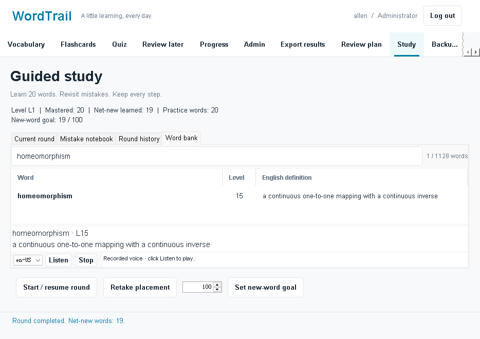
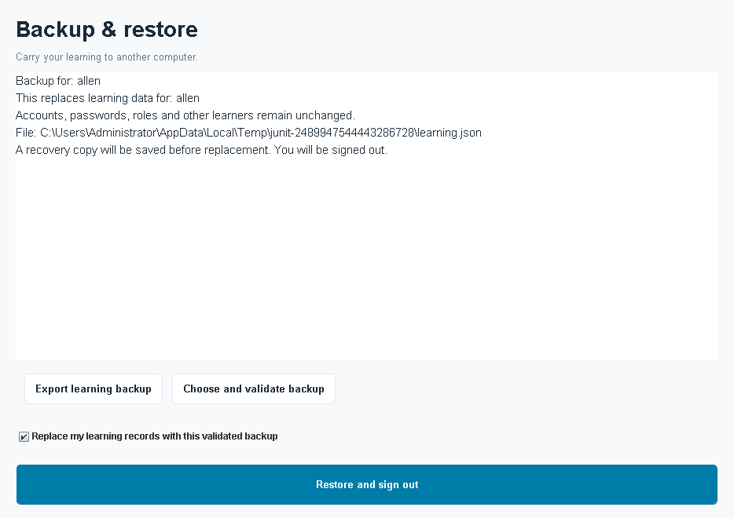

# Learning resources and portable backups

This extension is led by Zidong Yuan and builds on the guided-study work in PR #17.
It preserves the existing UC-09 CSV-export and UC-10 review-plan implementations.

## Recorded pronunciation

Choose **Listen** in Vocabulary, Review later, Flashcards, a guided question or
Study → Word bank. Select a US/UK preference; the status shows the actual accent,
source and license returned by the provider. A different available accent is
labelled honestly. **Stop**, changing words/tabs, signing out and closing the app
cancel playback and stale status callbacks. Nothing plays automatically.

The Dictionary API supplies recording links; broken proxies can recover from their
declared Wikimedia Commons source. Downloads have host restrictions, byte/time
limits and a small in-memory cache. MP3 and Ogg decoding run away from Swing's
event thread. Recordings require network access unless already cached in this
session. Failure leaves learning usable; there is no automatic synthetic fallback.

UC-13: As a learner, I want to hear a recorded pronunciation on demand.
Success: the selected recording plays with attribution. Alternatives: cancel,
unavailable word/network/decoder/device, or selection changes before loading ends.
Input boundary: PronunciationUseCase; interactor: PronunciationInteractor;
ports: PronunciationClient and PronunciationPlayer; controller: PronunciationController.
The reference client and MP3/Ogg implementation are adapted from the owned Java reference.

## Expanded English bank

Study → **Word bank** searches 1,128 distinct English words and their definitions.
All 60 legacy IDs and meanings are preserved. Additional vocabulary follows the
original Python project's selection across 15 levels. The original proper-name
entry `erika` is excluded. The larger bank is available offline in the JAR;
opening it does not add 1,128 words to personal progress.

The original 60-word CSV remains a compatibility fixture. The runtime bank is
`english-study-content.json`. The generator verifies the pinned ECDICT SHA-256,
uses an English dictionary sense (not a Chinese translation), and uses explicit
project gloss overrides for missing/unsuitable entries. This is not an exhaustive
multi-sense dictionary. Levels remain heuristic learning groups, not CEFR, a
standardized test, a complete exam list or a vocabulary-size estimate.

A 20-question placement samples all 15 levels. Adopting its result still immediately
replaces unfinished study; saved old rounds keep their exact questions and answers.
The existing 60-word exhaustion regression uses a deliberately bounded fixture;
a separate test verifies the full-bank placement and level-15 adoption.

To regenerate, download the pinned CSV linked in [content credits](CONTENT_CREDITS.md), then:

```text
python tools/import_english_content.py tools/english-word-selection.json /path/to/ecdict.csv
```

## Backup and restore

UC-14: As a signed-in learner, I want to move my learning data to another computer
and recover an earlier checkpoint.

1. Open **Backup & restore → Export learning backup** and choose a new JSON filename.
2. On the destination computer, create or sign into the intended account.
3. Choose **Choose and validate backup**. Inspect the source owner and destination
   account. The source username is informational and never determines account access.
4. Check **Replace my learning records with this validated backup**, then choose
   **Restore and sign out**. Sign back in to continue the restored round.

The archive contains that learner's private vocabulary, definition edits, review
list/counts/dates, study days, quiz results, goals, mistakes, mastery, history,
assessment and unfinished guided round. Referenced shared words travel with it.
Conflicting shared vocabulary is restored as private content, leaving the shared
catalog and other accounts unchanged. Accounts, password hashes, roles and the
administrator's shared question bank are not exported.

Validation checks the format/version, SHA-256 checksum, integer counters,
references and guided snapshots before writing. Input is capped at 16 MiB.
The file digest is checked again on restore, so a changed file must be revalidated.
The checksum detects accidental changes; it is not an authenticity signature.

Before replacement, the app writes a validated account recovery archive under
`<data-dir>/backups/before-restore-<id>.json`. If that fails, restore stops.
The existing atomic store then commits the complete replacement. Recovery uses
the same import workflow. Other accounts and credentials remain untouched.
Current question tokens are renewed and the UI signs out to discard stale decks.
Export/cancel and failed validation do not change learning data. Existing export
files are never overwritten; choose a different name. These JSON archives contain
personal learning history and should be kept private.

Input boundary: BackupUseCase; interactor: BackupInteractor; port: BackupRepository.
JsonFileStore owns the atomic account replacement; LearningBackupFiles handles
bounded files, checksums and export. Views talk only to display adapters.

## Verification (November 28, 2026)

- Maven verify: 186 tests passed; Entity and Use Case line coverage is 928/928 (100%).
- Real JSON tests cover another-account restore, password/role isolation, active
  checkpoint recovery, recovery-file round trip, shared-word collisions, invalid
  references/checksum, changed-after-preview files, oversize input and recovery-write failure.
- Silent audio tests cover actual Ogg decoding, HTTP fixtures, source attribution,
  host rejection, limits, cancellation and queued stale callbacks.
- Real Swing tests cover backup selection/cancellation/confirmation/sign-out,
  word-bank search and the existing learning workflows at 934×660 and 1080×780.
- Packaged JAR: existing UC-08/09/10 smoke test passed. Both the bundled Ogg fixture
  and a live `world` recording downloaded through the declared Commons source
  decoded silently. No audio device was opened.
- Native sound-device and listening acceptance remains a human review step.

```text
mvn verify
java tools/CheckPackage.java target/wordtrail.jar target/package-check
java -cp target/wordtrail.jar tools/CheckRecordedPronunciation.java src/test/resources/audio/hello-uk.ogg
java -jar target/wordtrail.jar --data-dir .wordtrail/resources-preview
```

Use a separate preview account/data folder until the PR is reviewed.



