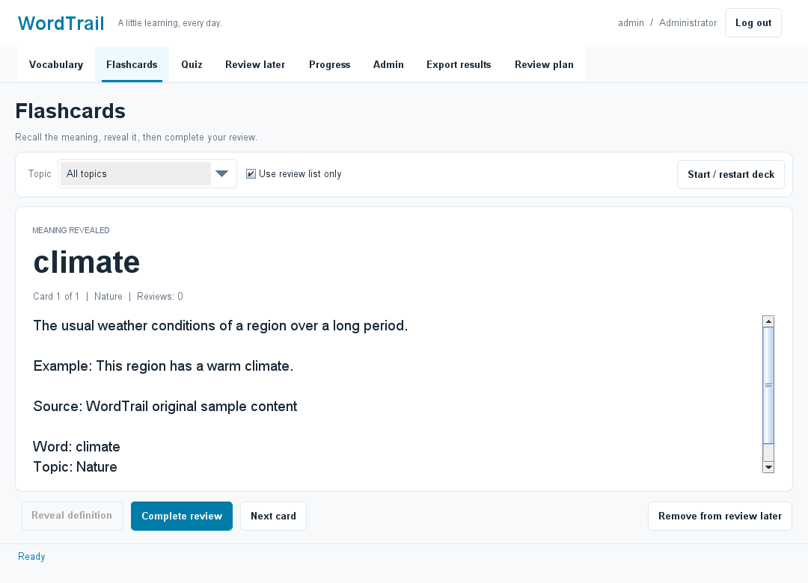
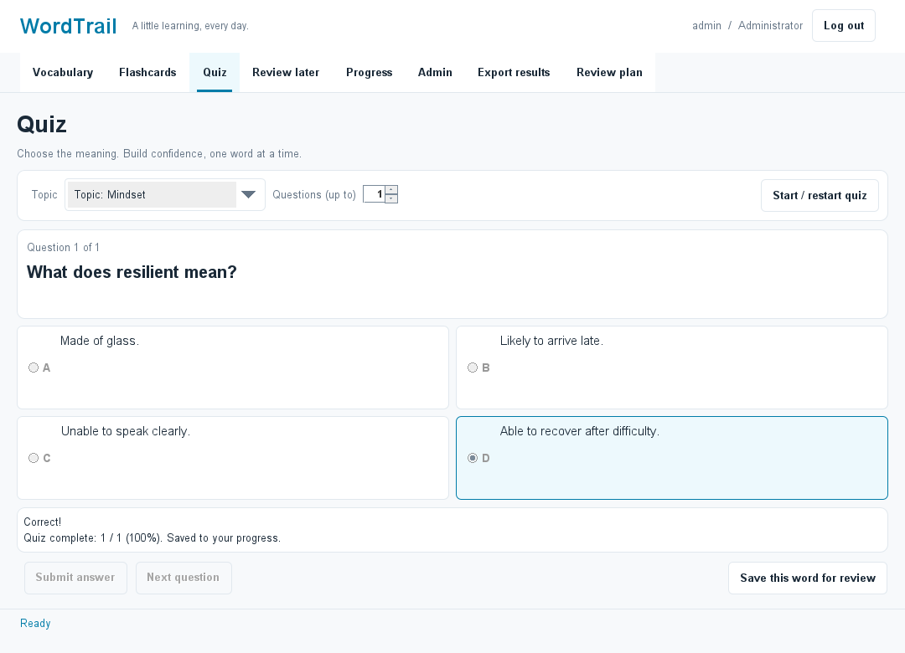

# Flashcards and Quiz UI preview

This increment follows the Vocabulary and Review later preview in PR #15.
PR #17 now consolidates both UI previews and guided study into one review against
`main`. Use `Emilia/reference-parity` for the complete preview; the earlier commits
and feedback remain available in PRs #15/#16.

## What changed

- Flashcards use a large word card, an explicit recall/revealed/completed state,
  and separated learning and review-list actions. Full words, topics and review
  counts remain available in selectable text if a heading is shortened.
- Quiz uses four answer cards in a two-by-two layout. Radio controls retain
  keyboard selection and expose the complete answer through their accessible
  descriptions. Questions, answer choices and feedback remain plain, wrapped,
  scrollable text.
- Both screens use the existing shared theme and bounded topic selector.
  No controller, Entity, Use Case, persistence, dependency or tab-order changes
  are included. Reveal-before-review, answer locking, next-question and saving
  behavior are preserved.

## Preview images

These images are actual Swing components rendered by automated tests with
synthetic data. No native desktop window, speech or network service is used.





At the 934 by 660 minimum client size, long text remains scrollable. The Quiz
answer cards are compact after feedback appears; a larger window shows more
lines. The complete text remains available in both cases.

Long-text stress fixtures remain in the automated tests. Their repeated-letter
placeholder screenshots have been removed from this user-facing preview; they
are not vocabulary content and are not included in the bundled word bank.

## Verification

Local Windows/JDK 11 verification on November 24, 2026:

- Maven `verify`: **155 tests**, no failures, errors or skips; executable JAR built.
- Entity and Use Case line coverage: **633 of 633 (100%)**.
- Packaged UC-08, UC-09 and UC-10, reopening persistence, account isolation and
  unchanged profile bytes during export/planning: **PASS**.
- Four new integration cases cover both screen sizes, 80-character words,
  50-character topics and long definitions, questions, answers and feedback.
  They verify scrolling to the final character, complete accessible answer
  descriptions, visible controls, reveal/review states, save/remove, and quiz
  next/completion behavior.

Headless Swing tests perform a second layout pass because scrollbar changes
can alter wrapped text height; native Swing normally schedules that validation.
These automated checks do not substitute for native desktop review.

## Run and review

Use a separate checkout of `Emilia/reference-parity`, JDK 11 or 17 and
installed Maven 3.9+. Build with `mvn verify`, then run:

```text
java -jar target/wordtrail.jar --data-dir .wordtrail/learning-preview
```

Use only a fresh test profile. Check Flashcards before/after Reveal, Complete
review, Next card and save/remove. In Quiz, choose by mouse and keyboard,
submit a wrong and correct answer, advance, finish and save a word. Resize to
the minimum window and try long content. Record the revision and actual result;
native desktop acceptance remains pending until a teammate runs these checks.
