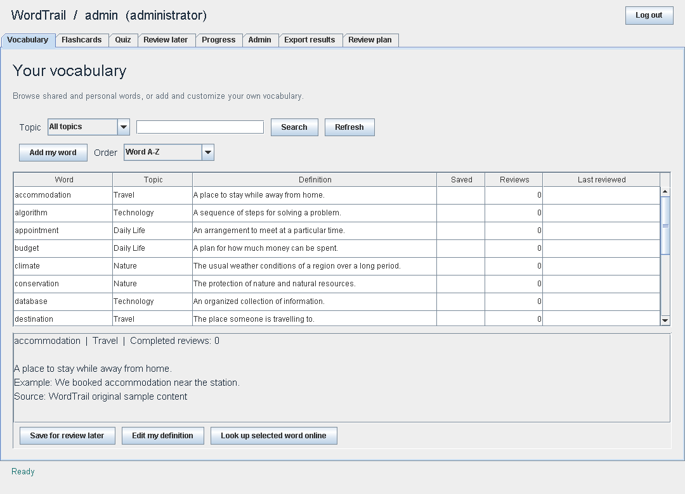
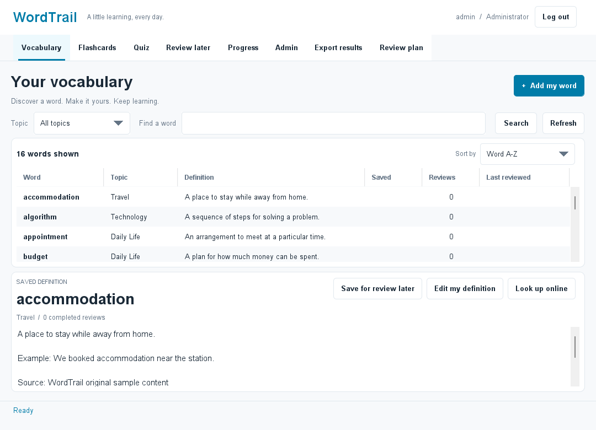
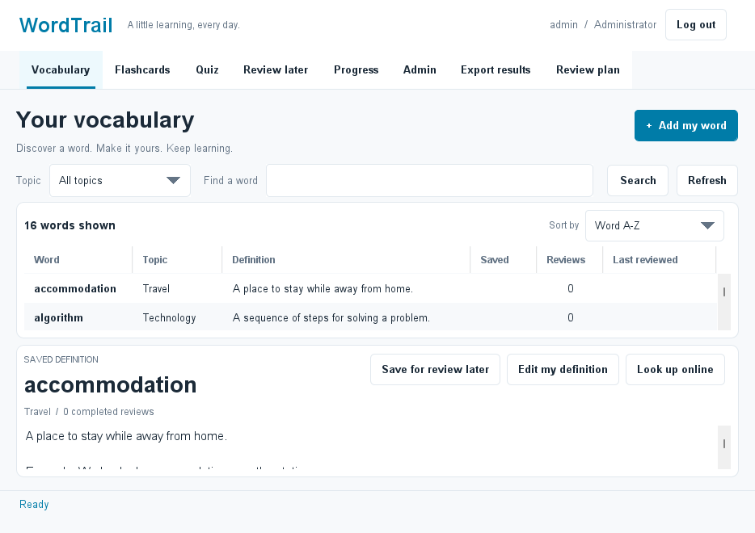
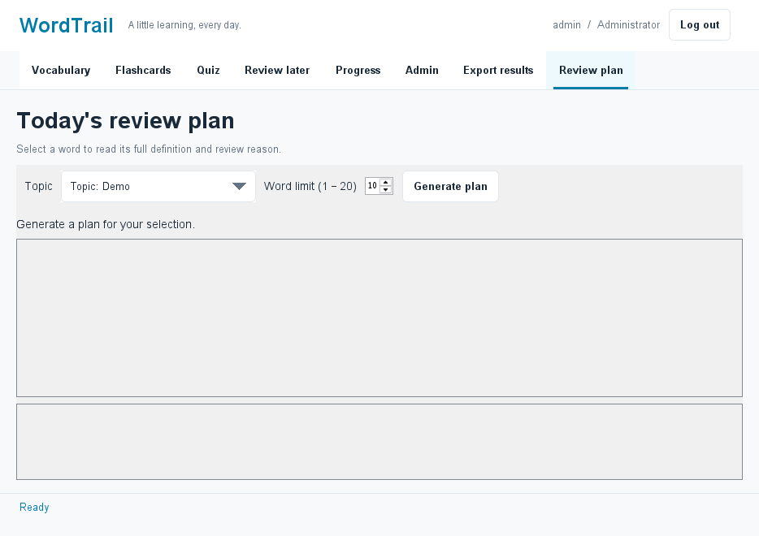

# Vocabulary UI preview

This is the first visual sample on `Emilia/library-ui-refresh`, based on
published `main` at `77ea22e`. It is a proposal for visual review, not a completed
redesign of every screen.

## What changed

- A light background, white cards, blue primary action, consistent controls and
  an underlined tab navigation retain the existing Java/Swing application.
- Vocabulary now separates search, the word collection and the selected word's
  definition. The selected term is prominent, the result count reflects the
  current filter, and empty results clear the previous word's details.
- The shared Review later view receives the same layout. Shared styling also
  affects headings and controls on other screens; their full layouts are still
  candidates for a later increment.
- User-entered words and dictionary text remain plain text. Existing component
  names, tab order, typed table sorting, asynchronous work, personal edits and
  persistence are retained. No Entity, Use Case, adapter, data or dependency
  changes are included.

## Screenshots

These are actual Swing components rendered by automated tests with synthetic
data, without opening a desktop window or accessing a dictionary service.
The preview images use the Windows system look and feel at the given client
sizes. The older baseline uses the existing test look and feel; it is included
as a layout comparison rather than a pixel-identical environment comparison.

### Earlier published layout



### Proposed layout — 1080 by 780



### Small window — 934 by 660 client area



Both cards remain scrollable. A small window displays fewer rows; the separator
can be dragged to give the word collection or definition more space, within
the minimum readable area for each card.

## Verification and review

Local Windows/JDK 11 verification on November 24, 2026:

- Maven `verify`: **151 tests**, no failures, errors or skips; executable JAR built.
- Entity and Use Case line coverage: **633 of 633 (100%)**, unchanged scope.
- Packaged UC-08, UC-09 and UC-10 wiring, persistence and account-isolation probe:
  **PASS** against the generated JAR.
- New checks cover selected-word/count updates, empty results, disabled actions,
  and readable/unclipped primary controls at 934 by 660 and 1080 by 780. They
  render Vocabulary, Review later and the personal editor in populated/empty states.
- Source architecture checks remain part of the passing suite. Tests do not
  establish native desktop acceptance at every operating-system scale factor.

### Long-topic correction from peer testing

[Xinyu's native test](https://github.com/fanfan170721/team-project/pull/15#issuecomment-7135722812)
found that a 50-character topic could push the Review plan controls outside a
small window, even while a shorter topic was selected. The shared topic selector
now keeps a 240-pixel closed width; hover text retains the full topic name both
on the selected control and on popup entries. Stored names and filtering values
are unchanged.

Two integration regressions failed on the previous revision and pass with the
correction. They exercise Review plan, Flashcards and Quiz at 934 by 660, including
the long topic itself, topic refresh, invalid limit `0`, recovery to `10` and
unchanged profile bytes after generating a plan. Native rechecking of this
revision is still pending.



Before extending this design to more screens, review the overall spacing and
word readability. For functional peer review, search and sort, save/remove a
word for later, edit a personal definition, cancel an edit, and look up a word
without overwriting the saved meaning. The existing export and review-planning
flows should still behave normally.

## Run the preview

Open this branch as a separate project in IntelliJ and run
`com.wordtrail.app.Main`, or build with `mvn verify` using installed Maven 3.9+
and JDK 11 or 17. This repository does not include a Maven wrapper.
Start the generated JAR with a separate data directory:

```text
java -jar target/wordtrail.jar --data-dir .wordtrail/ui-preview
```

The profile folder is local test data. Do not commit it or reuse a teammate's
profile. Continue to use the normal reviewed branch for shared delivery until
this visual sample is accepted and reviewed.
